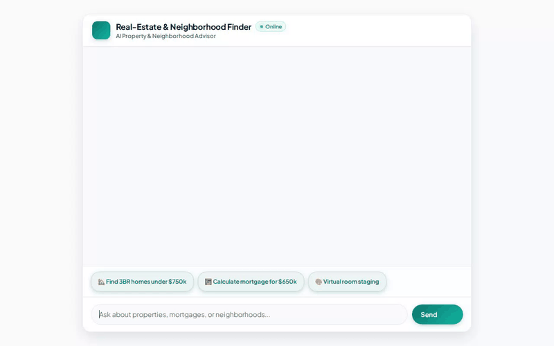

# Real Estate & Neighborhood Finder Assistant

An AI-powered conversational real estate assistant built with the Google Agent Development Kit (ADK) and Google Cloud Vertex AI. The agent helps home buyers search for property listings, evaluate neighborhood specs, perform mortgage calculations, and generate AI virtual room staging photos and walkthrough videos.



---

## 🚀 Key Capabilities & Implemented Tools

### 🏡 Property Listing & Database Search (Cloud Firestore)
- **`search_properties`**: Queries Cloud Firestore for available listings based on criteria such as maximum price, bedrooms, bathrooms, and city.
- **`get_property_details`**: Retrieves full property listing details from Firestore by property ID.
- **`add_property`**: Creates and persists new real estate property listings directly in Cloud Firestore.

### 🧠 Cross-Session Long-Term Memory (Vertex AI Memory Bank)
- **Memory Persistence**: Integrates `VertexAiMemoryBankService` and `PreloadMemoryTool` with an `after_agent_callback` (`add_session_to_memory`) to extract and remember user preferences, budget limits, target locations, and health/environmental sensitivities (such as allergies or pet preferences) across chat sessions.

### 🎨 AI Image Generation & Virtual Room Staging (Google Imagen 3 & Cloud Storage)
- **`generate_property_image`**: Uses Google Imagen 3 (`imagen-3.0-generate-002`) to generate virtual room staging and interior redesign concepts.
- **Artifact & Cloud Storage Publishing**: Saves generated images as Playground artifacts and uploads in-memory image bytes directly to a public Google Cloud Storage bucket (`real-estate-finder-media-qwiklabs-gcp-03-e7a096ab7ace`) to return public HTTPS image URLs.

### 🎬 AI Walkthrough Video Generation (Google Omni & Cloud Storage)
- **`generate_property_video`**: Uses Google's Omni model (`gemini-omni-flash-preview` in `location="global"`) via the Interactions API to generate virtual property walkthrough videos.
- **Artifact & Storage Upload**: Saves generated MP4 video bytes as Playground artifacts and uploads them to Google Cloud Storage for public web rendering.

### 🧮 Financial Calculations & Code Sandbox
- **`calculate_mortgage_payment`**: Calculates estimated monthly principal, interest, property taxes, and total mortgage payments based on home price, down payment percentage, interest rate, and loan term.
- **Code Executor (Sandbox)**: Configured with ADK's safe Python code executor (`get_sandbox_code_executor`) for executing complex financial calculations safely.

### 📍 Maps & Neighborhood Discovery
- **`lookup_zip_location`**: Resolves ZIP codes to city and state information.
- **`geocode_address`**: Converts street addresses into latitude and longitude geographic coordinates.
- **`find_nearby_places`**: Finds nearby schools, parks, grocery stores, and amenities for a given location.

### 🎨 Responsive UI Cards (A2UI Protocol)
- Integrates ADK A2UI schema manager (`A2uiSchemaManager` version 0.8) and `a2ui_callback` to format property search results, listing details, mortgage summaries, and generated media into structured display cards.

---

## ☁️ Google Cloud Services Integrated

- **Vertex AI Agent Runtime (Reasoning Engines)**: Hosted serverless agent runtime in `us-east1`.
- **Vertex AI Memory Bank**: Centralized long-term memory engine for cross-session user memory.
- **Cloud Firestore**: NoSQL document database storing real estate property listings.
- **Google Cloud Storage**: Public bucket hosting generated virtual staging photos and property videos.
- **Google GenAI Models**:
  - `gemini-2.5-flash` (Core agent reasoning and conversation)
  - `imagen-3.0-generate-002` (Virtual room staging images)
  - `gemini-omni-flash-preview` (Virtual property walkthrough videos)

---

## 🛠️ Local Setup & Run Instructions

### Prerequisites
- Python 3.11+
- Google Cloud SDK (`gcloud`) authenticated to your GCP project
- `uv` package manager installed (`pip install uv`)

### 1. Clone & Install Dependencies
```bash
cd real-estate-finder
uv sync
```

### 2. Run Agent Locally using ADK Web
You can run and test the agent locally using the ADK Web development UI:
```bash
adk web app
```

### 3. Run the Custom Web Chat Frontend Locally
To start the custom FastAPI proxy and web chat UI:
```bash
cd frontend
uv sync

# Set deployment resource name and agent directory
export AGENT_ENGINE_RESOURCE_NAME="projects/<PROJECT_ID>/locations/<LOCATION>/reasoningEngines/<ENGINE_ID>"
export AGENT_DIRECTORY="app"
export PORT=8080

uv run python main.py
```
Then open your browser to the local server port configured above.

---

## 📁 Repository Structure

```
real-estate-finder/
├── README.md                   # Project documentation & overview
├── demo.gif                    # Animated inline demo recording
├── agents-cli-manifest.yaml    # Deployment manifest configuration
├── pyproject.toml              # Python project dependencies
├── app/                        # Agent application source code
│   ├── agent.py                # Main ADK agent definition & prompt
│   ├── firestore_tools.py      # Firestore database property tools
│   ├── financial_tools.py      # Mortgage calculation tools
│   ├── image_tools.py          # Imagen 3 virtual staging tool
│   ├── video_tools.py          # Omni video generation tool
│   ├── maps_tools.py           # Geocoding and places tools
│   ├── neighborhood_tools.py   # ZIP code lookup tools
│   ├── sandbox_config.py       # Code executor sandbox setup
│   └── a2ui_utils.py           # A2UI callback transformer
└── frontend/                   # Web chat frontend application
    ├── main.py                 # FastAPI proxy server (A2A protocol)
    └── static/
        └── index.html          # Custom web chat interface HTML/CSS/JS
```
